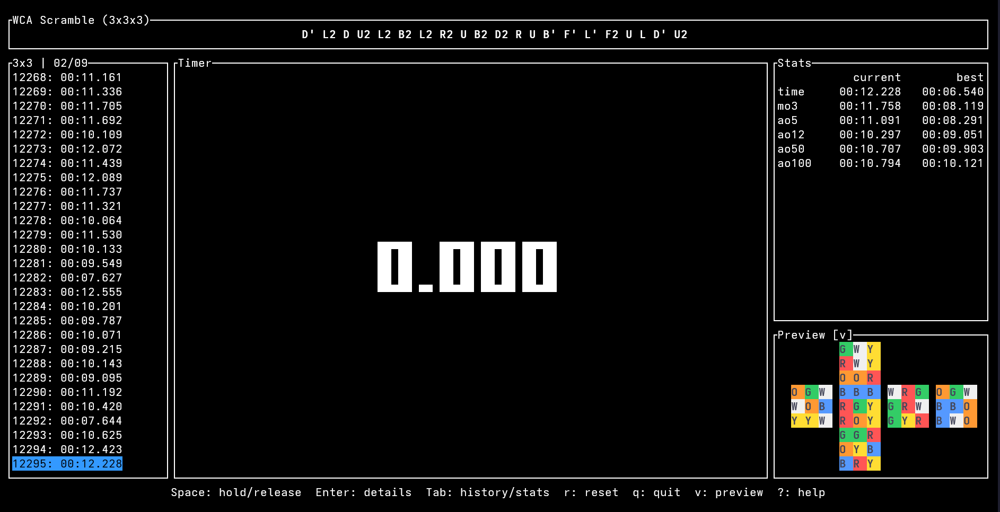

# cube-tui

[](https://crates.io/crates/cube-tui)

A terminal UI timer and session manager for speedcubing.



Out of the box, it's a lightweight TUI timer that lets you time solves, scramble, and check basic stats directly from
your terminal. All your session data is saved locally.

## Requirements

- [Rust & Cargo](https://rustup.rs/)
- [Bun](https://bun.sh/) (required for the `dashboard` feature)

## Installation & Features

You can install the app globally using Cargo. By default, it installs the core terminal app without any heavy
dependencies:

```sh
cargo install cube-tui
```

Scrambles are official WCA random-state scrambles, generated by `tnoodle-rs`, a Rust port of
[tnoodle-lib](https://github.com/thewca/tnoodle-lib) included in this repository (`crates/tnoodle-rs`), so no Java
installation is needed.

If you want extra functionality, you can enable specific features during installation depending on your setup.

### Dashboard

Spins up a local web server (localhost) with a companion app. This web UI can be used to look at your solve history and
advanced statistics.

To install with the dashboard included:

```sh
cargo install cube-tui --features dashboard
```

*Note: The build script will automatically use Bun to install dependencies and build the web frontend, embedding it
directly into the executable.*

### Bluetooth

Allows the app to connect directly to Bluetooth Low Energy (BLE) timers. Right now, only the GAN timer is supported.

To install with Bluetooth support:

```sh
cargo install cube-tui --features bluetooth
```

### All Features

If you want dashboard and Bluetooth timer support:

```sh
cargo install cube-tui --all-features
```

### Build from Source

If you installed from source, you can also run it directly from the project root:

```sh
cargo run --release
```

## Usage

Run the terminal app:

```sh
cube
```

To see all the commands run

```sh
cube --help
```

## Events

Press the configured `next_event` and `previous_event` keys to cycle through:

| Event | Scrambler | Inspection |
| --- | --- | --- |
| 2x2x2 | `PuzzleRegistry::Two` | Normal |
| 3x3x3 | `PuzzleRegistry::Three` | Normal |
| 3x3x3 OH | `PuzzleRegistry::Three` | Normal |
| 3x3x3 BLD | `PuzzleRegistry::ThreeNi` | None |
| 4x4x4 | `PuzzleRegistry::Four` | Normal |
| 4x4x4 BLD | `PuzzleRegistry::FourNi` | None |
| 5x5x5 | `PuzzleRegistry::Five` | Normal |
| 5x5x5 BLD | `PuzzleRegistry::FiveNi` | None |
| 6x6x6 | `PuzzleRegistry::Six` | Normal |
| 7x7x7 | `PuzzleRegistry::Seven` | Normal |
| Megaminx | `PuzzleRegistry::Mega` | Normal |
| Pyraminx | `PuzzleRegistry::Pyra` | Normal |
| FTO | `PuzzleRegistry::Fto` | Normal |
| Skewb | `PuzzleRegistry::Skewb` | Normal |
| Square-1 | `PuzzleRegistry::Sq1` | Normal |
| Clock | `PuzzleRegistry::Clock` | Normal |

Blindfolded events never start inspection, whatever the `inspection` setting
says. Their statistics show a success rate next to the best single and mean of
three. One-handed solves are stored as their own event, so they never mix with
two-handed 3x3x3 statistics.

`times.json` is shared with cube-app. Fields and events written by a newer
cube-app are kept when cube-tui saves, so the two can be upgraded in either
order.

## Your data

Solves are saved in `times.json`, in the folder `cube --data` prints. The
`CUBE_DATA_DIR` environment variable replaces that folder.

Press `Ctrl+Z` to undo the last solve or session deletion, repeatedly if needed,
and `Ctrl+Y` to redo it. Undo lasts until you quit, and both keys can be rebound.

Backups of `times.json` are made automatically. To go back to one, close the app
and run:

```sh
cube backups           # list them, newest first
cube restore <NUMBER>  # replace the history with one of them
```

Restoring and importing first back up the current history, so both can be
reversed the same way. A backup that does not load is refused.

If `times.json` can't be read, the app says so and leaves the file alone: it
saves nothing until you restore a backup or repair the file. If that happens
while it is running, your solves are kept in `times.unsaved.json` beside it.

## Settings

- [Backups](docs/settings.md)
- [Custom theme](docs/settings.md)
- [Custom layout](docs/settings.md)
- [Custom keybinds](docs/settings.md)
